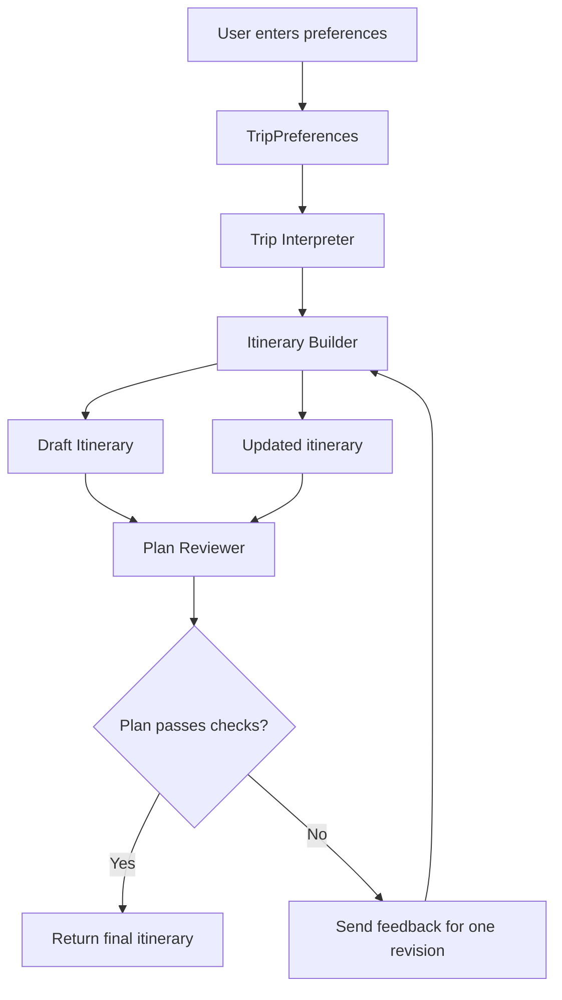

# Travel Planner Architecture

## Multi-Agent Workflow

## Trip Interpreter Agent

**Purpose:** Validate and normalize the user's trip preferences before passing them to the itinerary builder.

**Input:**
- `TripPreferences` object containing the destination, trip duration, total budget, interests, pace, and optional budget breakdown.

**Responsibilities:**
1. Validate that the trip duration and total budget are positive.
2. Check that any provided category budget allocations are nonnegative.
3. Normalize interests by removing extra whitespace and converting them to lowercase.
4. Return the cleaned trip preferences for the next agent.

**Output:** A validated and normalized `TripPreferences` object.

**Error handling:** Reject invalid preferences with a clear error message so the user can correct them.

**Out of scope:** Selecting attractions, creating daily schedules, and reviewing the completed itinerary.

## Itinerary Builder Agent

**Purpose:** Create a day-by-day itinerary based on the user's preferences and the available attractions.

**Input:**
- Validated `TripPreferences`
- List of available `Attraction` objects

**Responsibilities:**
1. Select attractions that match the user's interests.
2. Group attractions by area where practical.
3. Distribute activities across the trip according to its duration and the user's preferred pace.
4. Estimate activity costs and create a daily schedule.

**Output:** An `Itinerary` object containing daily plans and estimated activity costs.

## Plan Reviewer Agent

**Purpose:** Check the generated itinerary for potential problems.

**Input:**
- `TripPreferences`
- Generated `Itinerary`

**Responsibilities:**
1. Check whether estimated activity costs exceed the total trip budget.
2. Check whether the schedule is too crowded for the user's preferred pace.
3. Identify issues and suggest adjustments.

**Output:** A review result indicating whether the itinerary passes the checks and listing any issues found.

## Agent Workflow

1. The user provides their trip preferences.
2. The Trip Interpreter validates and normalizes the preferences.
3. The Itinerary Builder creates a proposed itinerary using the attraction dataset.
4. The Plan Reviewer checks the itinerary and reports any issues.
5. If necessary, the itinerary can be adjusted and reviewed again, with a limited number of revision attempts.