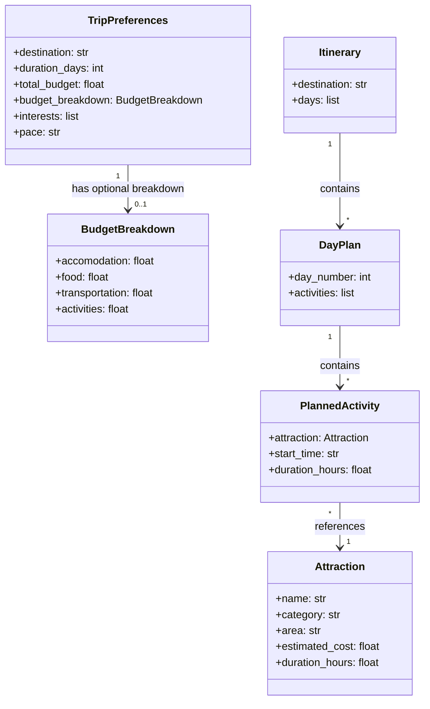

# Travel Planner Data Model

This diagram shows the main data structures
used by the travel planning system.

## 1. Purpose

The data models define how the travel planning system represents user preferences, available attractions, scheduled activities, daily plans, and complete itineraries.

These models provide a consistent structure for exchanging information between the system's agents.

## 2. Model Descriptions

### 2.1 TripPreferences

**Purpose:** Stores the user's travel preferences and trip requirements.

| Field | Type | Description | Example |
|---|---|---|---|
| destination | str | City or region the user wants to visit | Tokyo |
| duration_days | int | Number of days in the trip | 4 |
| total_budget | float | Total estimated budget for attractions and activities | 1500.00 |
| budget_breakdown | BudgetBreakdown \| None | Optional category level budget alloactions | `BudgetBreakdown(accommodation=600.0, food=300.0, transportation=None, activities=200.0)` |
| interests | list[str] | Categories of activities the user enjoys | ["food", "culture"] |
| pace | str | Preferred itinerary intensity | relaxed |

### 2.2 Budget Breakdown

**Purpose:** Stores optional spending allocations for different categories of a trip.

| Field | Type | Description | Example |
|---|---|---|---|
| accomodation | float \| None | Planned lodging budget | 600.00 |
| food | float \| None | Planned food budget | 300.00 |
| transportation | float \| None | Planned local transportation budget | None |
| activities | float \| None | Planned attractions and tours budget | 200.00 |

### 2.3 Attraction

**Purpose:** Represents a place that the system may recommend.

| Field | Type | Description | Example |
|---|---|---|---|
| name | str | Name of the attraction | Senso-ji Temple |
| category | str | Type of attraction | culture |
| area | str | Neighborhood or geographic area | Asakusa |
| estimated_cost | float | Estimated cost per visitor | 0.00 |
| duration_hours | float | Estimated time needed for a visit | 1.5 |

### 2.4 PlannedActivity

**Purpose:** Represents an attraction scheduled as part of a particular itinerary.

| Field | Type | Description | Example |
|---|---|---|---|
| attraction | Attraction | The attraction being visited | Senso-ji Temple |
| start_time | str | Planned local start time | 10:00 |
| duration_hours | float | Planned visit duration | 1.5 |

### 2.5 DayPlan

**Purpose:** Groups scheduled activities for one day of the trip.

| Field | Type | Description | Example |
|---|---|---|---|
| day_number | int | Position of the day within the trip | 1 |
| activities | list[PlannedActivity] | Activities scheduled for the day | Two planned activities |
| estimated_cost | float | Total estimated activity cost for the day | 25.00 |

### 2.6 Itinerary

**Purpose:** Represents the complete travel plan generated by the system.

| Field | Type | Description | Example |
|---|---|---|---|
| destination | str | Destination of the trip | Tokyo |
| days | list[DayPlan] | Daily plans for the trip | Four day plans |
| total_estimated_cost | float | Total estimated activity cost across the itinerary | 150.00 |

## 3. Model Relationships

- A TripPreferences may have zero or one BudgetBreakdown.
- An Itinerary contains multiple DayPlan objects.
- Each DayPlan contains zero or more PlannedActivity objects.
- Each PlannedActivity references one Attraction.
- TripPreferences provides the initial requirements used to generate the itinerary.

## 4. Design Decisions

- Python dataclasses will represent the models.
- Type annotations will document the expected types of fields.
- Basic validation will prevent invalid values, such as a trip duration of zero days.
- Costs will initially represent attractions and activities, excluding flights and accommodation.
- The initial version will use a small, predefined attraction dataset.
- The models will be independent of the agent implementations so they can be tested separately.
- Every trip must have a total budget.
- The category breakdown is optional. If omitted, budget_breakdown is None.
- Users can specify category allocations independently.
- Each field that is optional and defaults to None.
- None means the user has not specified a budget for that category.
- 0.0 means the user has explicitly allocated zero to that category.
- If provided, allocations must be nonnegative.
- Category allocations do not have to add up to the total budget. Unallocated money is allowed.
- The initial budget covers accommodation, food, local transportation, and activities. Flights are excluded from the first version.

## 5. Future Extensions

- UserFeedback to represent likes, dislikes, and skipped recommendations.
- Accommodation data for hotel recommendations.
- Geographic coordinates to improve location grouping and travel-time estimates.
